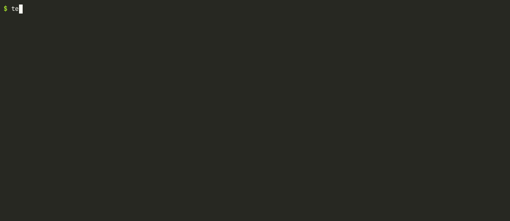

# embedded-telemetry-daemon

**A Linux telemetry recorder with a CRC-protected UDP downlink, written in C++17 with no external dependencies.**

[](https://github.com/bekirhankarakurt/embedded-telemetry-daemon/actions/workflows/ci.yml)
[](https://github.com/bekirhankarakurt/embedded-telemetry-daemon/actions/workflows/codeql.yml)
[](https://bekirhankarakurt.github.io/embedded-telemetry-daemon/coverage/)
[](https://github.com/bekirhankarakurt/embedded-telemetry-daemon/releases/latest)
[](LICENSE)




**Documentation:** [API reference and coverage report](https://bekirhankarakurt.github.io/embedded-telemetry-daemon/) ·
[Releases](https://github.com/bekirhankarakurt/embedded-telemetry-daemon/releases) · [Changelog](CHANGELOG.md)

## Why / what

- **Health monitoring for embedded Linux nodes.** Samples CPU, memory, swap, load, uptime and network
  counters from `/proc` and `sysinfo()` at a fixed rate (up to 1 kHz).
- **Live downlink to a "ground station".** Every sample goes out as a fixed 196-byte big-endian packet
  with a CRC-32 (or as JSON). The bundled receiver checks integrity and reports lost or reordered packets.
- **Black-box recording.** Samples are also written as JSON lines with size-based rotation. Disk errors
  are reported and counted but never stop the daemon.
- **Real-time safe sampling path.** The sampling thread never blocks on I/O: UDP is non-blocking and the
  logger sits behind a bounded ring buffer that counts overflows.
- **No dependencies.** Standard library plus Linux/POSIX only. Builds warning-free on GCC and Clang with
  `-Werror`, and the CI runs ASan+UBSan and TSan builds.

## Demo

Real output: listener in one terminal, daemon at 2 Hz for 3.2 s in another.

```console
$ ./build/telemetry_listener --port 5000
listening on 0.0.0.0:5000 (Ctrl+C to stop)
[bin ] seq=0      cpu=  0.0% mem=624/16091 MiB load=0.86/0.26/0.14 rx=0.0 KiB/s tx=0.0 KiB/s up=1269s age=0.5ms
[bin ] seq=1      cpu=  0.0% mem=614/16091 MiB load=0.86/0.26/0.14 rx=0.1 KiB/s tx=0.1 KiB/s up=1270s age=0.4ms
[bin ] seq=2      cpu=  0.0% mem=610/16091 MiB load=0.86/0.26/0.14 rx=0.0 KiB/s tx=0.0 KiB/s up=1270s age=0.4ms
[bin ] seq=3      cpu=  1.0% mem=597/16091 MiB load=0.86/0.26/0.14 rx=0.0 KiB/s tx=0.0 KiB/s up=1271s age=0.4ms
[bin ] seq=4      cpu=  0.5% mem=592/16091 MiB load=0.86/0.26/0.14 rx=0.0 KiB/s tx=0.0 KiB/s up=1271s age=0.4ms
[bin ] seq=5      cpu=  0.5% mem=588/16091 MiB load=0.86/0.26/0.14 rx=0.0 KiB/s tx=0.0 KiB/s up=1272s age=0.4ms
^C
summary: binary=6 json=0 invalid=0 lost=0 reordered=0 restarts=0
```

```console
$ ./build/embedded-telemetry-daemon --rate-hz 2 --duration 3.2 --verbose
embedded-telemetry-daemon 1.0.0: 2 Hz, udp=127.0.0.1:5000 (binary), log=telemetry.jsonl
status: samples=2 seq=1 cpu=1.0% read_fail=0 | udp sent=2 dropped=0 err=0 | log lines=2 rot=0 err=0 overflow=0
status: samples=4 seq=3 cpu=0.0% read_fail=0 | udp sent=4 dropped=0 err=0 | log lines=4 rot=0 err=0 overflow=0
status: samples=6 seq=5 cpu=0.5% read_fail=0 | udp sent=6 dropped=0 err=0 | log lines=6 rot=0 err=0 overflow=0
shutdown (duration): samples=6 seq=5 cpu=0.5% read_fail=0 | udp sent=6 dropped=0 err=0 | log lines=6 rot=0 err=0 overflow=0
```

One line of the log (`telemetry.jsonl`):

```json
{"type":"telemetry","v":1,"seq":0,"mono_ns":1268805130285,"wall_ns":1793818891271066900,"cpu_pct":0.000,"mem_total_kb":16477348,"mem_avail_kb":15837640,"mem_used_kb":639708,"swap_total_kb":0,"swap_free_kb":0,"uptime_s":1269,"load1":0.863,"load5":0.257,"load15":0.142,"net_rx_bytes":46179225,"net_tx_bytes":12508083,"net_rx_packets":15533,"net_tx_packets":15436,"net_rx_errors":0,"net_tx_errors":0,"net_rx_drops":6,"net_tx_drops":0,"net_rx_Bps":0.000,"net_tx_Bps":0.000}
```

## Quick start (60 seconds)

```bash
git clone https://github.com/bekirhankarakurt/embedded-telemetry-daemon.git
cd embedded-telemetry-daemon
cmake -S . -B build -DCMAKE_BUILD_TYPE=Release
cmake --build build -j
ctest --test-dir build
```

```bash
./build/telemetry_listener --port 5000          # terminal 1
./build/embedded-telemetry-daemon --verbose     # terminal 2, Ctrl+C to stop
```

## Requirements

| Component | Version                        | Notes                                           |
|-----------|--------------------------------|-------------------------------------------------|
| OS        | Linux                          | Uses `/proc`, `sysinfo(2)`, `pipe2(2)`          |
| Compiler  | GCC ≥ 9 or Clang ≥ 10          | CI uses GCC 13 and Clang 18                     |
| CMake     | ≥ 3.16                         |                                                 |
| Optional  | `libclang-rt-<ver>-dev`        | Sanitizer runtimes for Clang on Debian/Ubuntu   |

## Build options

| CMake option            | Default   | Effect                                              |
|-------------------------|-----------|-----------------------------------------------------|
| `CMAKE_BUILD_TYPE`      | `Release` | `Debug`, `Release`, `RelWithDebInfo`                |
| `ETD_WERROR`            | `OFF`     | Treat warnings as errors                            |
| `ETD_SANITIZE_ADDRESS`  | `OFF`     | AddressSanitizer + UndefinedBehaviorSanitizer       |
| `ETD_SANITIZE_THREAD`   | `OFF`     | ThreadSanitizer (exclusive with the above)          |
| `ETD_BUILD_TESTS`       | `ON`      | Build unit tests and register them with CTest       |

### Install / uninstall

```bash
sudo cmake --install build --prefix /usr/local
```

This installs `bin/embedded-telemetry-daemon`, `bin/telemetry_listener` and
`lib/systemd/system/embedded-telemetry-daemon.service`. To uninstall, remove the recorded files:

```bash
sudo xargs rm -v < build/install_manifest.txt
```

## CLI reference

| Option                | Default           | Description                                                     |
|-----------------------|-------------------|-----------------------------------------------------------------|
| `--rate-hz <hz>`      | `1`               | Sampling rate, `0 < hz <= 1000`                                 |
| `--dest <ipv4>`       | `127.0.0.1`       | UDP destination (dotted quad)                                   |
| `--port <port>`       | `5000`            | UDP destination port, 1–65535                                   |
| `--broadcast`         | off               | Enable `SO_BROADCAST`; `--dest` defaults to `255.255.255.255`   |
| `--format <fmt>`      | `binary`          | Downlink payload: `binary` or `json`                            |
| `--log-file <path>`   | `telemetry.jsonl` | JSON-lines log file                                             |
| `--log-max-kb <kb>`   | `1024`            | Rotate before the file would exceed this size                   |
| `--log-backups <n>`   | `3`               | Rotated files kept (`path.1` … `path.N`); `0` truncates in place |
| `--no-log`            | –                 | Disable file logging                                            |
| `--no-udp`            | –                 | Disable the UDP downlink                                        |
| `--duration <s>`      | `0`               | Stop after *s* seconds; `0` runs until SIGINT/SIGTERM           |
| `--verbose`           | –                 | One status line per second on stderr                            |
| `--help`, `--version` | –                 |                                                                 |

Both `--opt value` and `--opt=value` are accepted. Listener options: `--port`, `--bind <ipv4>`, `--quiet`.

**Exit codes** (`sysexits.h` conventions): `0` success, including a signal-triggered shutdown;
`64` invalid command line; `70` internal error; `71` OS resource error (socket, pipe, bind).

### Recipes

**1. Daily desktop monitoring.** Log only, one sample every 5 s, about 10 MB of history:

```bash
./build/embedded-telemetry-daemon --no-udp --rate-hz 0.2 \
    --log-file ~/telemetry.jsonl --log-max-kb 2048 --log-backups 4
```

**2. Raspberry Pi → laptop downlink.** On the laptop (here `192.168.1.50`):

```bash
./build/telemetry_listener --port 5000
```

On the Pi, 5 Hz binary downlink plus a 4 MB × 7 local black box:

```bash
./build/embedded-telemetry-daemon --dest 192.168.1.50 --port 5000 --rate-hz 5 \
    --log-file pi.jsonl --log-max-kb 4096 --log-backups 7
```

To reach every host on the subnet, use `--broadcast --dest 192.168.1.255` instead.

**3. systemd service.** Requires the install step above:

```bash
sudo systemctl daemon-reload
sudo systemctl enable --now embedded-telemetry-daemon
journalctl -u embedded-telemetry-daemon -f
```

The unit runs as a `DynamicUser` in a strict sandbox (`ProtectSystem=strict`, no capabilities,
`AF_INET`/`AF_UNIX` only) and logs to `/var/log/embedded-telemetry/`. It stops gracefully on SIGTERM
and is not restarted after a configuration error (exit 64). Edit `ExecStart` to change the destination.

**4. Live check with standard tools.** Read the JSON stream with netcat:

```bash
nc -u -l 5000 &
./build/embedded-telemetry-daemon --format json --no-log --rate-hz 2
```

Or inspect the binary packets. `TLMY` appears right after the 8-byte UDP header:

```bash
sudo tcpdump -i lo -X udp port 5000
```

```text
IP localhost.47672 > localhost.5000: UDP, length 196
	0x0010:  7f00 0001 ba38 1388 00cc fedf 544c 4d59  .....8......TLMY
	0x0020:  0101 00a8 0000 0000 0000 0000 0000 014f  ...............O
```

`01` is the version, `01` the type, `00a8` the payload length (168) and `0000000000000000` is seq 0.

## Architecture

```
  /proc/stat ----+
  /proc/meminfo -+--> +--------------------+   sink, same thread
  /proc/net/dev -+    |  Collector thread  |--------+-----------------------+
  sysinfo() -----+    |  absolute N Hz     |        |                       |
                      |  steady_clock grid |        v                       v
                      +--------------------+   UdpSender              BoundedQueue<Sample>
                                               non-blocking sendto    ring, drop-oldest,
                                                    |                 overflow counter
                                                    |                       |
                                                    |                       v
                                                    |              +------------------+
                                                    |              |  Logger thread   |
                                                    |              |  JSON + rotation |
                                                    |              +------------------+
   Main thread: CLI, signal self-pipe, --duration,  |                       |
   status, ordered shutdown                         v UDP                   v
                                           telemetry_listener      telemetry.jsonl(.1..N)
```

### Threading model

| Thread    | Does                                                         | May block?                         |
|-----------|--------------------------------------------------------------|------------------------------------|
| main      | parses the CLI, `poll()`s the signal pipe, prints status, shuts down | yes                          |
| collector | samples on an absolute schedule, sends UDP, enqueues for the logger | no (non-blocking socket, O(1) push) |
| logger    | dequeues, serializes, writes and rotates files               | yes, isolated by the queue         |

- SIGINT and SIGTERM are blocked in the worker threads, so they are always delivered to the main thread.
- The signal handler only stores to a lock-free `std::atomic<bool>` and `write(2)`s one byte to a
  non-blocking self-pipe.
- Shutdown order: the collector stops, the queue closes, the logger drains and joins, then a summary
  is printed.
- Counters shared across threads are atomics. The code is TSan-clean.

### Design trade-offs

- **UDP on the collector thread, disk I/O on its own thread.** A non-blocking `sendto()` is bounded and
  cheap, which keeps downlink latency minimal. Disk writes can stall for milliseconds (for example on SD
  cards), so they sit behind the ring buffer.
- **Drop-oldest on overflow.** For telemetry, fresh data matters most. The producer never blocks, and
  every loss is counted (`overflow`, `dropped`) rather than hidden.
- **Absolute schedule, skip on overrun.** Ticks follow a fixed `steady_clock` grid, so jitter does not
  accumulate. After a stall the collector skips missed ticks instead of sending a burst.
- **Explicit byte-wise serialization.** Portable across endianness and ABIs, with no `#pragma pack`, no
  aliasing UB (`memcpy` for doubles), and `static_assert`s that pin the layout.
- **Application CRC-32.** The UDP checksum is optional on IPv4 and is not end-to-end across serial or
  radio bridges. The CRC also catches serialization bugs.
- **IPv4 literal addresses only.** No DNS, so there is no resolver blocking at start-up. This matches
  fixed-address embedded networks.
- **Pure `std::istream` parsers.** The `/proc` parsers are unit-tested against fixtures, and the
  collector's `/proc` root is configurable.

## Binary wire format (v1)

Big-endian throughout. `f64` is the IEEE-754 binary64 bit pattern sent as a `u64`. The packet is 196 bytes.

| Offset | Size | Type   | Field                                                      | Notes                          |
|-------:|-----:|--------|------------------------------------------------------------|--------------------------------|
| 0      | 4    | u32    | magic                                                      | `0x544C4D59` = `"TLMY"`        |
| 4      | 1    | u8     | version                                                    | `1`                            |
| 5      | 1    | u8     | message type                                               | `1` = telemetry                |
| 6      | 2    | u16    | payload length                                             | `168`                          |
| 8      | 8    | u64    | sequence number                                            | starts at 0 per daemon run     |
| 16     | 8    | u64    | timestamp                                                  | `CLOCK_MONOTONIC`, ns          |
| 24     | 8    | u64    | wall_ns                                                    | `CLOCK_REALTIME`, ns           |
| 32     | 8    | f64    | cpu_pct                                                    | 0–100                          |
| 40     | 40   | 5×u64  | mem_total, mem_avail, mem_used, swap_total, swap_free      | KiB                            |
| 80     | 8    | u64    | uptime_s                                                   |                                |
| 88     | 24   | 3×f64  | load1, load5, load15                                       |                                |
| 112    | 64   | 8×u64  | rx/tx bytes, rx/tx packets, rx/tx errors, rx/tx drops      | sum over non-loopback ifaces   |
| 176    | 16   | 2×f64  | net_rx_Bps, net_tx_Bps                                     | bytes/s over the last period   |
| 192    | 4    | u32    | CRC-32                                                     | IEEE 802.3 over bytes 0–191    |

Receivers must reject packets whose magic, version, type, length or CRC does not match.

## Testing and sanitizers

| Test             | Covers                                                                                             |
|------------------|----------------------------------------------------------------------------------------------------|
| `parsers`        | `/proc/stat`, `/proc/meminfo` (incl. pre-3.14 fallback), `/proc/net/dev` fixtures, CPU %, counter reset |
| `wire_format`    | CRC-32 reference vectors, binary round-trip, header byte order, all rejection paths, bit-flip detection, JSON |
| `bounded_queue`  | FIFO order, drop-oldest accounting, close/drain, concurrent producer/consumer                      |
| `rolling_logger` | Rotation and backup count in a temp dir, truncate mode, append to existing file, unwritable path, async drain |
| `udp_sender`     | Address validation, loopback send/receive/decode, move semantics, broadcast socket                |
| `collector`      | Fake `/proc` root, rate math, missing sources, threaded sampling, prompt stop                      |

```bash
cmake -S . -B build-asan -DCMAKE_BUILD_TYPE=Debug -DETD_SANITIZE_ADDRESS=ON
cmake --build build-asan -j
ctest --test-dir build-asan --output-on-failure
```

```bash
cmake -S . -B build-tsan -DCMAKE_BUILD_TYPE=Debug -DETD_SANITIZE_THREAD=ON
cmake --build build-tsan -j
ctest --test-dir build-tsan --output-on-failure
```

CI runs {GCC, Clang} × {Release, ASan+UBSan, TSan} with `-Werror`. Each job runs the unit tests plus
`scripts/smoke_test.sh`: the daemon sends 3 s at 50 Hz to the listener, and the script checks for zero
loss, log-line count equal to packets received, correct rotation and the exit codes.

Further CI jobs:

| Job | What it does |
|-----|--------------|
| static analysis | `cppcheck` and `clang-tidy` (configured by the committed [`.clang-tidy`](.clang-tidy)); both must pass |
| coverage | `--coverage` build, unit tests + smoke test, `gcovr` report (≥ 75 % lines enforced); badge and HTML published to GitHub Pages |
| docs | Doxygen API docs (`Doxyfile`, warnings are errors), published to GitHub Pages |
| CodeQL | `security-and-quality` queries for C/C++, weekly and on every push |
| release | on a `v*` tag: static `linux-x86_64` and `linux-aarch64` tarballs + `SHA256SUMS` attached to a GitHub Release |

Run the analysis locally:

```bash
cppcheck --enable=warning,style,performance,portability --error-exitcode=1 --inline-suppr \
    --std=c++17 -I include --suppress=missingIncludeSystem --quiet src tools tests
cmake -S . -B build-tidy -DCMAKE_EXPORT_COMPILE_COMMANDS=ON -DCMAKE_CXX_COMPILER=clang++
clang-tidy -p build-tidy --quiet src/*.cpp tools/*.cpp
```

## Troubleshooting / FAQ

| Symptom | Cause and fix |
|---------|---------------|
| `bind: Address already in use` (listener exits 71) | Another process owns the port: `ss -ulpn 'sport = :5000'`. Stop it or use `--port`. |
| `logger: cannot open '…': Permission denied (will retry)` | The daemon keeps sampling and sending but cannot write the log. Pick a writable `--log-file`, or run the systemd unit (it gets `/var/log/embedded-telemetry/`). `err=` in the status line counts failures. |
| Listener shows nothing | Check that the daemon prints `udp sent=` > 0. Check `--dest`/`--port` match the listener and that the listener binds `0.0.0.0` or the right interface. Look at the wire with `tcpdump -i any udp port 5000`. Check the receiver's firewall. |
| `error: 255.255.255.255 requires --broadcast` | Broadcast needs `SO_BROADCAST`. Add `--broadcast`. |
| Broadcast sent but never received | Firewalls usually drop broadcast. Allow it on the receiver, for example `sudo ufw allow 5000/udp` or `sudo firewall-cmd --add-port=5000/udp`. Prefer the subnet broadcast (`192.168.1.255`) over `255.255.255.255`, which most routers and Wi-Fi APs do not forward. |
| `udp ... dropped=N` grows | Kernel send buffer full (`EAGAIN`/`ENOBUFS`). Lower `--rate-hz` or check the NIC/link. |
| `log ... overflow=N` grows | The disk cannot keep up with the sample rate. Lower `--rate-hz` or use faster storage. |
| `cpu=0.0%` at high rates | `/proc/stat` updates in jiffies (`CONFIG_HZ`, usually 100–1000 Hz). Short periods on an idle system can have no busy ticks. |

## Project layout

```text
.
├── include/
│   ├── telemetry_data.hpp    # sample model, wire constants, CRC-32, JSON/binary codec API
│   ├── collector.hpp         # /proc parsers + sampling thread
│   ├── udp_sender.hpp        # RAII non-blocking UDP socket
│   ├── bounded_queue.hpp     # drop-oldest ring buffer (header-only template)
│   └── rolling_logger.hpp    # rotating file + async logger thread
├── src/
│   ├── main.cpp              # daemon: CLI, wiring, signals, shutdown
│   └── *.cpp                 # implementations, built into the static library etd_core
├── tools/
│   └── telemetry_listener.cpp# ground-station receiver
├── tests/                    # CTest suites, /proc fixtures, temp-dir helper
├── scripts/smoke_test.sh     # end-to-end loopback test used by CI and coverage
├── systemd/                  # hardened service unit
├── docs/                     # demo GIF + recording script, GitHub Pages landing page
├── .github/
│   ├── workflows/            # ci.yml, codeql.yml, release.yml
│   ├── ISSUE_TEMPLATE/       # bug report, feature request
│   ├── PULL_REQUEST_TEMPLATE.md
│   └── dependabot.yml        # weekly GitHub Actions updates
├── CMakeLists.txt
├── Doxyfile  .gcovr.cfg  .clang-format  .clang-tidy
└── CHANGELOG.md  CONTRIBUTING.md  SECURITY.md  LICENSE
```

## Roadmap

- [x] /proc + sysinfo collector with drift-free scheduling
- [x] CRC-32 binary wire format and JSON lines
- [x] Rotating log with bounded queue and overflow accounting
- [x] Ground-station listener with gap/reorder detection
- [x] CI matrix with sanitizers, hardened systemd unit
- [x] Static analysis, coverage, CodeQL, API docs and tagged releases
- [ ] Per-core CPU and thermal zones (`/sys/class/thermal`)
- [ ] Optional IPv6 / multicast downlink
- [ ] Configuration file in addition to CLI flags
- [ ] Listener CSV export and simple plotting script
- [ ] Packaging (`.deb`) and cross-compilation toolchain file for ARM

## Contributing and security

See [CONTRIBUTING.md](CONTRIBUTING.md) for build, test and style rules. Report vulnerabilities privately as
described in [SECURITY.md](SECURITY.md).

## License

MIT — see [LICENSE](LICENSE).

Bekirhan Karakurt - [github.com/bekirhankarakurt](https://github.com/bekirhankarakurt)
